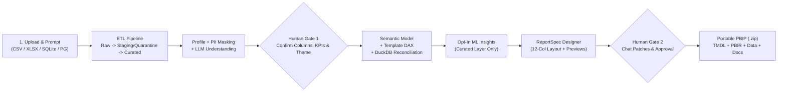

<p align="left">
  
</p>

# AutoBI Studio

**AutoBI** transforms uploaded tabular datasets (CSV, Excel, or read-only SQLite/PostgreSQL tables) and a natural-language analytics prompt into:

- An audited three-layer dataset (`raw` -> `staging`/`quarantine` -> `curated` Parquet + DuckDB) with column-level lineage
- A curated Power BI **Semantic Model** with allowlisted, DuckDB-reconciled **DAX measures**
- Interactive **Plotly & Matplotlib report previews** rendered from real curated data before any Power BI file exists
- Optional **grounded ML insights** (anomaly detection, forecasting vs. seasonal naive, supervised modeling, KMeans clustering) where every narrative number is verified against code-computed evidence
- A portable **Power BI Project (PBIP: TMDL + PBIR) `.zip`** bundled with curated `/data`, `measures.dax`, a formula-injection-neutralised `data_dictionary.xlsx`, `verification_report.md`/`.json`, and a manual open checklist (plus automatic fallback build guide if schema validation fails)

---

## Architecture Overview



See [docs/architecture.md](docs/architecture.md) for full module responsibilities and the raw/staging/curated data flow, and [docs/pbip_schema_research.md](docs/pbip_schema_research.md) for targeted Microsoft PBIP/TMDL/PBIR JSON schema versions.

---

## Setup

**Prerequisites**: Python **3.12+**

```bash
# 1. Clone and enter the repository
git clone <your-repo-url>
cd AutoBI

# 2. Create and activate a virtual environment
python -m venv .venv
# Windows PowerShell:
.venv\Scripts\Activate.ps1
# macOS / Linux:
# source .venv/bin/activate

# 3. Install AutoBI and development tools
pip install -e ".[dev]"

# Optional extras:
# pip install -e ".[dl]"     # PyTorch LSTM forecaster (disabled by default via ENABLE_DL=false)
# pip install -e ".[faiss]"  # Optional FAISS backend (ChromaDB is installed by default)

# 4. Configure environment variables
cp .env.example .env
```

By default `.env.example` sets `LLM_PROVIDER=mock`, so you can run the full app, tests, and evaluation suite completely offline without an API key. To use a live OpenAI-compatible provider, set `LLM_PROVIDER=openai` (or `groq`/`ollama`) and `LLM_API_KEY=<your-key>` in `.env`.

---

## Demo Script

### 1. Run Linting & Fast Tests

```bash
python scripts/lint.py               # Ruff lint check
python scripts/test.py -m "not slow" # Fast unit, security & prompt-injection suite
python scripts/test.py               # Full suite including E2E, ML/DL & Streamlit AppTest
```

### 2. Launch the Interactive Streamlit Demo

```bash
python scripts/run.py
# (equivalent to: streamlit run app/main.py)
```

Walk through the 4 numbered pages in the sidebar:

1. **1. Upload & Prompt**: Open the **SYNTHETIC Sample Datasets** tab, select `Sales (SYNTHETIC_sales.csv)`, enter `"Build an executive sales dashboard with revenue trends and regional breakdown"`, and click **Run ETL, Profiling & Understanding**. Inspect the PII scan summary.
2. **2. Data Profile & Confirm**: Review row reconciliation (`read == staged == curated + rejected + duplicates`), quality-gate checks, column stats, and lineage. Edit any column role or friendly name in the table and click **Save Confirmed Column Roles**.
3. **3. Prompt & KPI Builder**: Inspect the parsed `UserIntent`, select/rename registry-backed KPIs, pick a theme (`Executive Navy`), optionally toggle ML insights, and click **Confirm & Build Semantic Model, DAX & Report Preview**.
4. **4. Report Preview & Export**:
   - Inspect interactive Plotly visuals and full-page Matplotlib layout previews computed from curated DuckDB data.
   - Type a chat refinement such as `Change title to Q4 Board Review and switch theme to Emerald Slate` to apply a validated `ReportSpecPatch`.
   - Expand **Under the hood** to inspect every DAX measure side by side with its reconciled DuckDB SQL and result.
   - Click **Approve Design & Generate PBIP Package** and download the portable `.zip`, `measures.dax`, `data_dictionary.xlsx`, and `verification_report.md`.
   - Optionally click **Delete my data** in the sidebar to permanently purge the isolated session workspace.

### 3. Run the Evaluation & Scale Suite

```bash
python evals/rag_eval.py       # 20-question RAG Hit-Rate@3 evaluation
python evals/pipeline_eval.py  # 6-dataset end-to-end eval + 200,000-row mandi scale benchmark
```

Evaluation reports are written to `output/evals/pipeline_eval_report.json` and `output/evals/pipeline_eval_report.md`.

---

## Known Limitations (Honest List)

1. **PBIP projects have NOT been opened inside a live Power BI Desktop instance**: Generated TMDL and PBIR files are validated offline against JSON schemas modelled on `microsoft/json-schemas`, TMDL symbol checks, and zero-overlap layout checks. Manual verification in Power BI Desktop (using the checklist inside each bundle's `README.md`) is required, and optional `visualContainerObjects` sub-properties may evolve across monthly Power BI Desktop updates.
2. **Power Query M `DataFolderPath` parameter must be updated after unzipping**: Power BI Desktop's `File.Contents()` requires an absolute local filesystem path at refresh time. AutoBI parameterises all table partitions via `DataFolderPath = "../data"` in `expressions.tmdl`; users update that single parameter in *Transform data -> Edit parameters* after unzipping.
3. **RAG knowledge base requires human domain review**: Every KPI and DAX pattern entry in `knowledge/` carries `needs_human_review: true` until reviewed and signed off by a domain analyst.
4. **Single-machine scale envelope**: ETL, profiling, and DuckDB reconciliation run in-process on a single machine. The 200,000-row mandi-price scale benchmark completes cleanly in seconds, but multi-million-row enterprise warehouses should be aggregated upstream or connected via SQL rather than uploaded as raw CSVs (default upload limits: `MAX_UPLOAD_MB=50`, `MAX_ROWS=500000`).
5. **`MockLLM` is deterministic for offline demos and tests**: Running with `LLM_PROVIDER=mock` uses heuristic/registry defaults for dataset understanding, KPI selection, report layout, and chat patches; richer natural-language reasoning requires configuring a real LLM provider in `.env`.
6. **Optional deep-learning forecasting (`ENABLE_DL=false`)**: The PyTorch LSTM forecaster is disabled by default because classical baselines (seasonal naive and lag gradient boosting) are faster and often outperform neural models on short tabular business time series.
7. **In-memory background worker**: `BackgroundWorker` uses a local `ThreadPoolExecutor` suitable for single-node Streamlit deployments; multi-replica production deployments would require an external task queue (e.g. Celery/RQ) and shared object storage.
