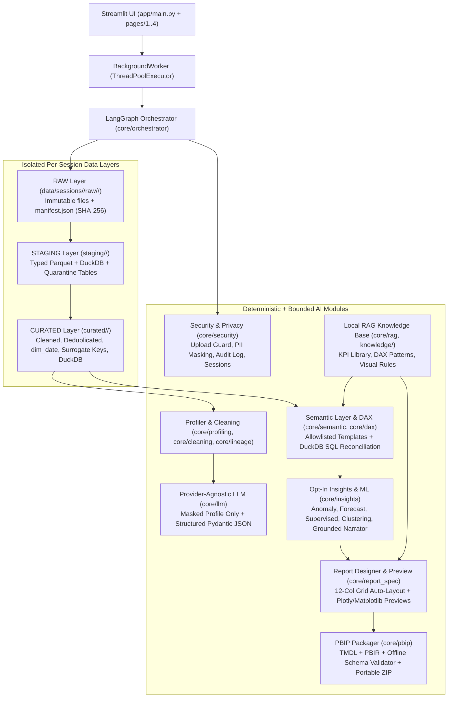
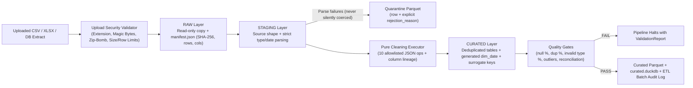

# AutoBI Architecture

AutoBI turns user-uploaded tabular datasets (CSV, Excel, or read-only SQLite/PostgreSQL tables) plus a natural-language analytics prompt into an audited semantic model, DuckDB-reconciled DAX measures, interactive visual previews, optional grounded ML insights, and a portable Power BI Project (PBIP: TMDL + PBIR).

## System Architecture



## Raw -> Staging/Quarantine -> Curated Data Flow

AutoBI enforces a strict three-layer medallion architecture inside each isolated session workspace (`data/sessions/<session_id>/`):



### Reconciliation Invariant

For every ingested table, `core/etl` records and enforces:

```text
rows_read == rows_staged == rows_curated + rows_rejected (quarantined) + rows_dropped_duplicates
```

If any row is unaccounted for, or if any configured quality-gate threshold is breached, the pipeline stops cleanly before writing curated outputs and surfaces the full `ValidationReport`.

## Module Responsibilities

| Module | Responsibility | Allowed Inputs / Outputs |
| --- | --- | --- |
| `core/config.py` | Typed `pydantic-settings` config loaded from `.env` (`SecretStr` for keys, limits, retention). | Environment / `.env` -> `Settings` |
| `core/logging.py` | Structured JSON logger with automatic secret redaction across messages, `%s` args, and extras. | `Settings` -> `logging.Logger` |
| `core/schemas/` | Shared Pydantic v2 contracts (`extra="forbid"` on core contracts). Only cross-module exchange layer. | Pydantic models |
| `core/security/` | Upload validation (extension, magic bytes, macro/password/zip-bomb, size/row limits), LLM sanitisation, spreadsheet formula neutralisation, PII detection/masking (email, phone, Luhn credit card, PAN, Aadhaar), isolated session workspaces, retention policy, `"delete my data"`, and secret-free JSONL audit log. | File paths / DataFrames -> `UploadValidationResult`, `PIIReport`, `SessionWorkspace`, `AuditEvent`, `DeletionReceipt` |
| `core/ingestion/` | Extract-only CSV (encoding & delimiter auto-detect), multi-sheet Excel (header-row detect), optional SQLite/Postgres via SQLAlchemy, and immutable raw store with SHA-256 `manifest.json`. | Input files / DB URL -> `DatasetBundle` |
| `core/storage/` | Parquet + DuckDB writers/readers for `staging`, `quarantine`, `curated`, and the persistent `etl_batch_log`. | DataFrames + metadata -> Parquet/DuckDB paths |
| `core/profiling/` | Semantic column type inference, descriptive stats, IQR & robust z-score outlier detection, duplicate/key/relationship discovery, and Matplotlib/Seaborn EDA charts. | Curated/staged DataFrames -> `ProfileReport` |
| `core/cleaning/` | Pure, idempotent executor over a strict 10-operation declarative JSON allowlist (`rename_column`, `cast_type`, `parse_date`, `trim_text`, `standardize_case`, `fill_null`, `drop_duplicates`, `drop_column`, `map_values`, `split_column`). Zero `eval`/`exec`, zero file I/O. | DataFrame + `CleaningPlan` -> `CleaningExecutionResult` |
| `core/lineage/` | Column-level lineage tracker emitting `LineageEvent` chains across cleaning, transformation, and ML steps. | Operation metadata -> `LineageGraph` |
| `core/transformation/` | Staging type-parser with quarantine routing, curated deduplication, `dim_date` calendar generation, surrogate keys, and relationship wiring. | Staged DataFrames -> `CuratedBuildSummary` |
| `core/validation/` | Configurable ETL quality gates (`null %`, `duplicate %`, `invalid type %`, `outlier %`, non-empty, reconciliation). | Curated + staging tables -> `ValidationReport` |
| `core/etl/` | Thin pipeline orchestrator coordinating Extract -> Stage/Quarantine -> Clean -> Transform -> Quality Gates -> Curated Load with SHA-256 idempotency. | Input files + plans + gates -> `ETLRunResult` |
| `core/llm/` | Provider-agnostic `BaseLLMClient`, `OpenAICompatibleLLMClient`, `MockLLM`, exponential-backoff retries, prompt-hash response caching, token/cost logging, and prompt-injection-hardened context builders receiving ONLY `ProfileReport` + masked samples. | `ProfileReport` + prompt -> `DatasetUnderstanding`, `UserIntent` |
| `core/rag/` & `knowledge/` | YAML/Markdown KPI library (8 domains), DAX patterns, and visual rules (all KPI/DAX flagged `needs_human_review: true`), chunked and indexed in local ChromaDB with deterministic embeddings and `evals/rag_eval.py`. | Query -> `list[RetrievedChunk]` |
| `core/semantic/` | Curated-layer `SemanticModel` builder (1:* single-direction relationships, marked `dim_date`, allowlisted `metrics_registry`) and registry-constrained KPI selector. | `ETLRunResult` + `DatasetUnderstanding` -> `SemanticModel`, `MetricSelectionPlan` |
| `core/dax/` | Deterministic DAX generator from 10 allowlisted templates (`SUM`, `AVERAGE`, `DISTINCTCOUNT`, `DIVIDE`, YoY, MoM, rolling avg, % of total, rank, top N), static DAX validator, and DuckDB SQL reconciler (`VERIFIED` / `UNVERIFIED` / `FAILED`). | `MetricSelectionPlan` + `SemanticModel` -> `list[DAXMeasureSpec]`, `VerificationReport` |
| `core/insights/` | Opt-in curated-layer ML: time-series anomaly detection (IsolationForest + robust z-score), forecasting evaluated against seasonal naive baseline, supervised training with leakage checks & CV, KMeans clustering with silhouette score, optional PyTorch LSTM (disabled by default), and number-grounded narrative verification. | Curated Parquet + `InsightsRequest` -> `InsightsSummary` |
| `core/report_spec/` | LLM-proposed `DraftReportSpec` validated deterministically against field-role rules, capped per page, auto-laid out onto a non-overlapping 12-column grid, styled with accessible themes, and rendered via Matplotlib + Plotly from real curated data. | `SemanticModel` + `DAXMeasureSpec` -> `ReportSpec` + previews |
| `core/pbip/` | Power BI Project generator emitting TMDL semantic models (`DataFolderPath` M parameter, marked `dim_date`, relationships, measures) and PBIR report definitions (pages, slicers, visuals, theme), validated offline against JSON schemas, packaged into a portable `.zip` with automatic fallback export (`STEP_BY_STEP_BUILD_GUIDE.md`). | `SemanticModel` + `ReportSpec` + `VerificationReport` -> `PBIPExportResult` |
| `core/orchestrator/` | 10-node LangGraph `StateGraph` with human-in-the-loop pause gates (`human_confirm`, `human_review`), per-session state persistence, duration logging, declarative `ReportSpecPatch` chat refinement, and `BackgroundWorker` thread pool. | Session inputs -> `PipelineSessionState` |
| `app/` | Thin Streamlit multi-page UI (`main.py`, `pages/1..4`, `components/`) containing zero business logic; wires `st.session_state`, progress bars, editable confirmation tables, interactive previews, chat refinements, downloads, and `"Delete my data"`. | User interactions -> `core/orchestrator` calls |
| `evals/` | Standalone evaluation harnesses: `rag_eval.py` (20-question Hit-Rate@3) and `pipeline_eval.py` (6-dataset accuracy, reconciliation, validation, and 200k-row mandi-price scale benchmark). | Evaluation datasets -> JSON + Markdown metrics |

## Security & Trust Boundaries

1. **No LLM Code Execution**: `eval()` and `exec()` are never used anywhere. LLMs output only strict Pydantic schemas over allowlisted operations, templates, and patch types.
2. **Data Minimisation & PII Masking**: Full datasets never leave the local machine. Only `ProfileReport` metadata and masked/sanitised sample rows (up to 5 rows) reach LLM prompts, wrapped in explicit `<UNTRUSTED_*>` tags.
3. **Secret Hygiene**: API keys live solely in `.env` as `SecretStr`, are stripped from logs/audit trails/prompts by `SecretRedactionFilter` and `AuditLogger`, and DB passwords are redacted via `redact_connection_url`.
4. **Session Isolation & Deletion**: Each session operates under `data/sessions/<session_id>/` and `output/sessions/<session_id>/`, is cleaned automatically after `RETENTION_HOURS`, and can be wiped immediately via **"Delete my data"**.

